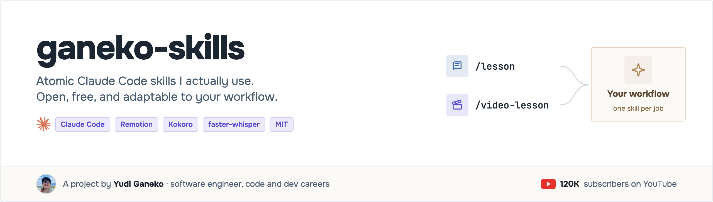
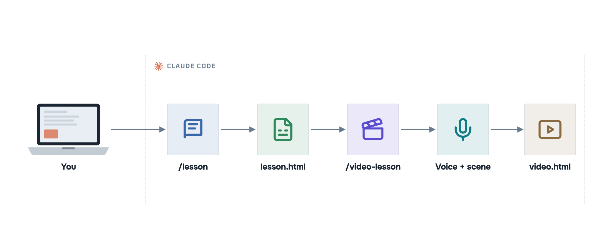

<p align="center"><a href="https://www.youtube.com/@yudiganeko"></a></p>

<p align="center">    <a href="LICENSE"></a></p>

<p align="center"><a href="README.pt-BR.md">Português</a></p>

**Atomic Claude Code skills I actually use**: each one does one job, so you can slot it into your own workflow and change it. Open source by default; paid services are an option, never a requirement.

<p align="center"></p>

> Everything here is **beta**: I use it daily and it still changes every week. Names and files may move.

## Install

Needs Claude Code, Python 3.10+, Node 18+ and ffmpeg.

```sh
git clone https://github.com/YudiG12/ganeko-skills && cd ganeko-skills
scripts/install.sh            # or: scripts/install.sh lesson
```

Or ask your AI coding agent:

```txt
Clone https://github.com/YudiG12/ganeko-skills and install the skills for me, following its AGENTS.md.
```

## How to use

```txt
/lesson what is an eval
/video-lesson what-is-an-eval
/video-lesson https://hamel.dev/blog/posts/evals/ --tts elevenlabs --voice <voice-id>
```

Everything lands in `./lessons/<slug>/`: `lesson.html`, then `video.mp4` and `video.html`.

| Skill | What it makes |
|---|---|
| [`lesson`](skills/beta/lesson) | One HTML lesson: a map up top, from the real problem to the technical name, terms, questions and primary sources. |
| [`video-lesson`](skills/beta/video-lesson) | A ~4 min narrated, animated video of any concept or source (a topic, a link, a PDF, or a `lesson.html`), plus a theater page with chapters and concept markers. |

Each skill ships a `STYLE.md` with my style as the default. Edit it and the output looks like yours.

## Architecture

| Concern | How | Decision |
|---|---|---|
| One job per skill | `lesson` writes, `video-lesson` films any source; `lesson.html` is one possible input | [ADR 001](docs/adr/001-atomic-skills.md) |
| Maturity | Everything starts in `skills/beta/` | [ADR 002](docs/adr/002-beta-folder.md) |
| Voice | Local Kokoro by default; any narrator is one `tts/<name>.py` | [ADR 003](docs/adr/003-open-source-by-default.md) |
| Sync | faster-whisper word times, so animation follows any voice | [ADR 003](docs/adr/003-open-source-by-default.md) |

```
skills/beta/
  lesson/          SKILL.md · STYLE.md
  video-lesson/    SKILL.md · STYLE.md · engine/ (Remotion) · tts/ · scripts/ · template/ · example/
scripts/install.sh
```

## Links

[ADRs](docs/adr) · [Changelog](CHANGELOG.md) · [Contributing](CONTRIBUTING.md) · [AGENTS.md](AGENTS.md) · MIT license. `video-lesson` renders with [Remotion](https://www.remotion.dev/license), which is free for individuals and companies up to 3 people. Fonts: SIL OFL 1.1. Voice: [Kokoro-82M](https://huggingface.co/hexgrad/Kokoro-82M), Apache 2.0.
