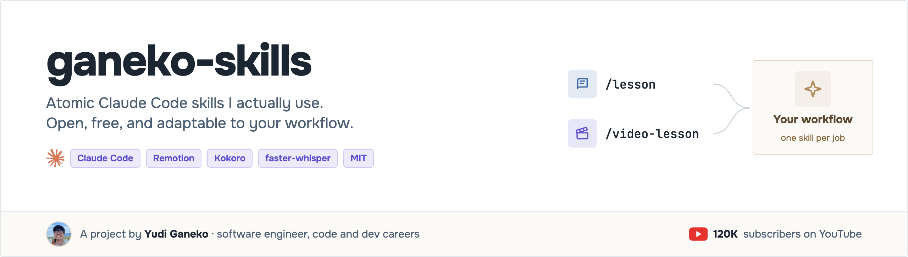
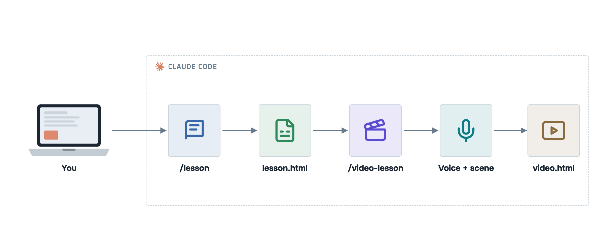

<p align="center"><a href="https://www.youtube.com/@yudiganeko"></a></p>

<p align="center">    <a href="LICENSE"></a></p>

<p align="center"><a href="README.md">English</a></p>

**Skills atômicas do Claude Code que eu uso de verdade**: cada uma faz um trabalho só, pra você encaixar no seu fluxo e mudar do seu jeito. Open source por padrão; serviço pago é opção, nunca obrigação.

<p align="center"></p>

> Tudo aqui está em **beta**: eu uso todo dia e ainda muda toda semana. Nomes e arquivos podem mudar.

## Instalar

Precisa de Claude Code, Python 3.10+, Node 18+ e ffmpeg.

```sh
git clone https://github.com/YudiG12/ganeko-skills && cd ganeko-skills
scripts/install.sh            # ou: scripts/install.sh lesson
```

Ou peça pro seu agente de IA:

```txt
Clona https://github.com/YudiG12/ganeko-skills e instala as skills pra mim, seguindo o AGENTS.md.
```

## Como usar

```txt
/lesson o que é um eval
/video-lesson o-que-e-um-eval
/video-lesson https://hamel.dev/blog/posts/evals/ --tts elevenlabs --voice <voice-id>
```

Tudo vai pra `./lessons/<slug>/`: `lesson.html`, depois `video.mp4` e `video.html`.

| Skill | O que gera |
|---|---|
| [`lesson`](skills/beta/lesson) | Uma aula em HTML: mapa no topo, do problema real até o nome técnico, termos, perguntas e fontes primárias. |
| [`video-lesson`](skills/beta/video-lesson) | Um vídeo narrado e animado de ~4 min de qualquer conceito ou origem (um tema, um link, um PDF ou um `lesson.html`), mais uma página de teatro com capítulos e marcadores de conceito. |

Cada skill traz um `STYLE.md` com o meu estilo como padrão. Edite e o resultado fica com a sua cara.

## Arquitetura

| Tema | Como | Decisão |
|---|---|---|
| Um trabalho por skill | `lesson` escreve, `video-lesson` filma qualquer origem; o `lesson.html` é uma entrada possível | [ADR 001](docs/adr/001-atomic-skills.md) |
| Maturidade | Tudo começa em `skills/beta/` | [ADR 002](docs/adr/002-beta-folder.md) |
| Voz | Kokoro local por padrão; qualquer narrador é um `tts/<nome>.py` | [ADR 003](docs/adr/003-open-source-by-default.md) |
| Sincronia | Tempo de cada palavra pelo faster-whisper, então a animação segue qualquer voz | [ADR 003](docs/adr/003-open-source-by-default.md) |

```
skills/beta/
  lesson/          SKILL.md · STYLE.md
  video-lesson/    SKILL.md · STYLE.md · engine/ (Remotion) · tts/ · scripts/ · template/ · example/
scripts/install.sh
```

## Links

[ADRs](docs/adr) · [Changelog](CHANGELOG.md) · [Contributing](CONTRIBUTING.md) · [AGENTS.md](AGENTS.md) · Licença MIT. A `video-lesson` renderiza com [Remotion](https://www.remotion.dev/license), grátis pra pessoa física e empresas de até 3 pessoas. Fontes: SIL OFL 1.1. Voz: [Kokoro-82M](https://huggingface.co/hexgrad/Kokoro-82M), Apache 2.0.
